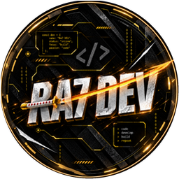
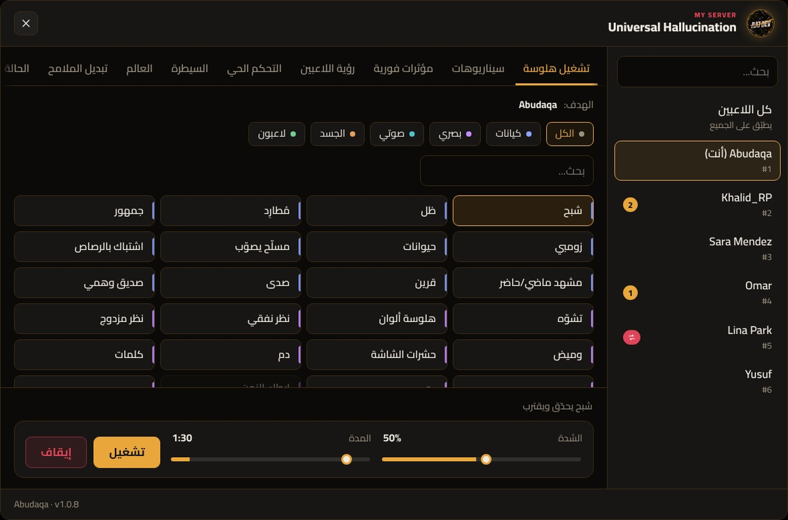
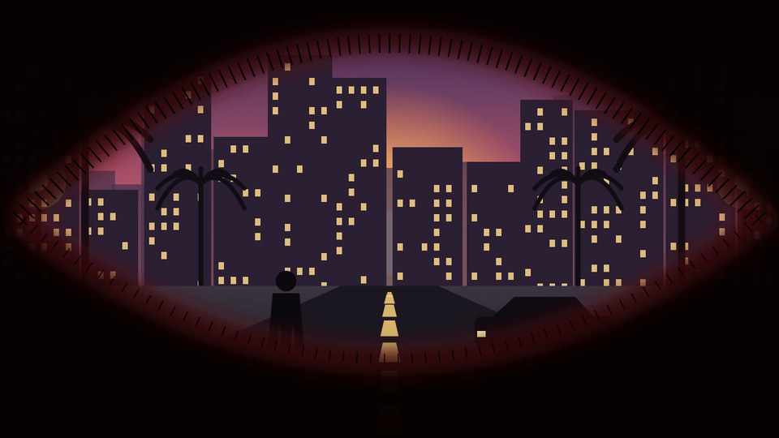
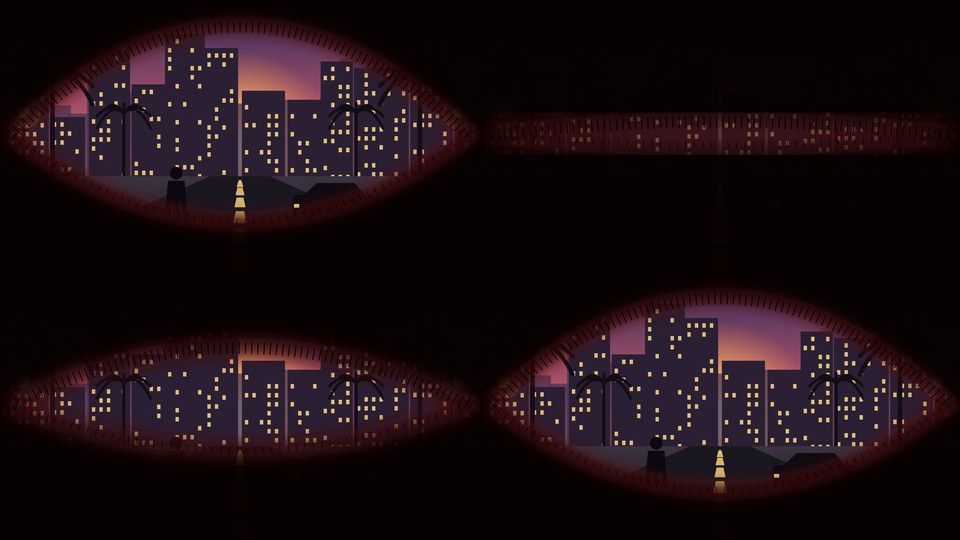
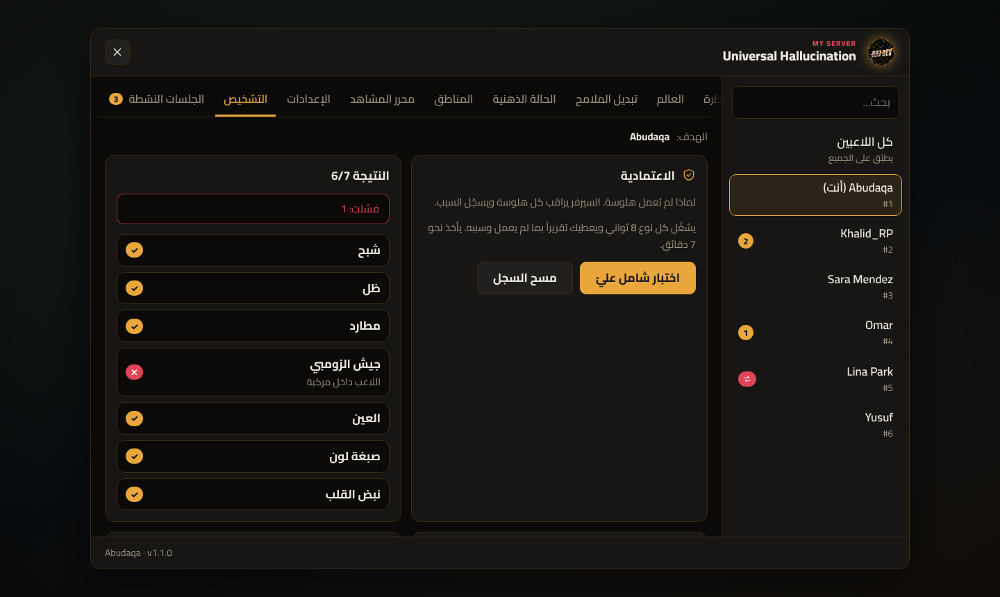
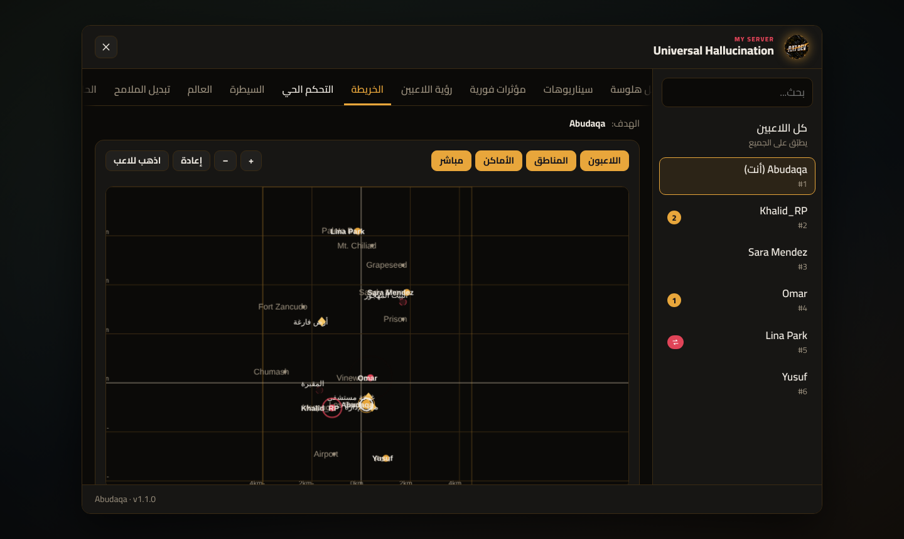
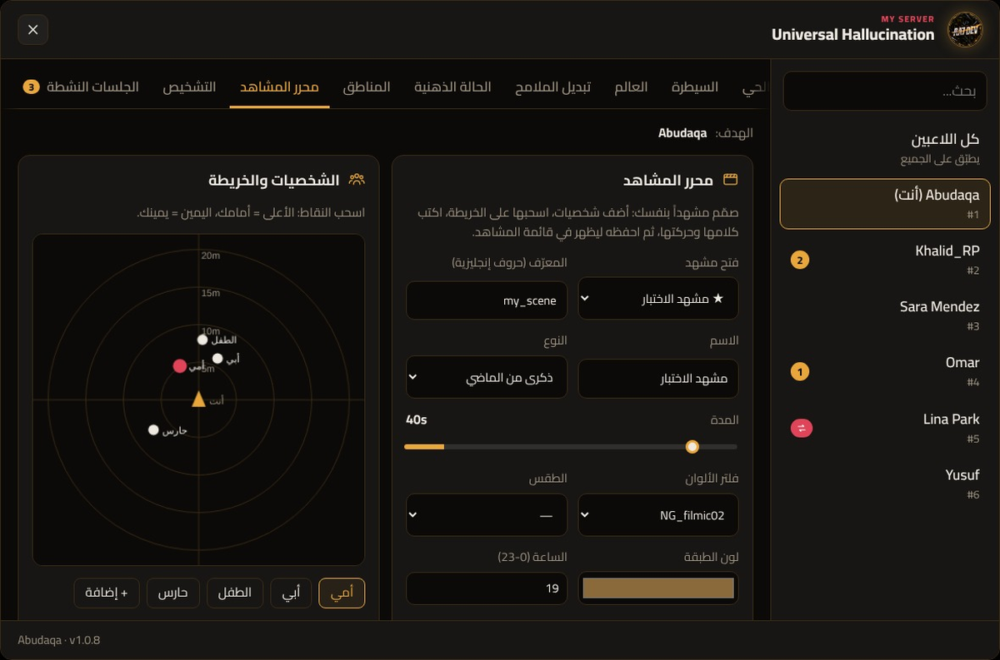
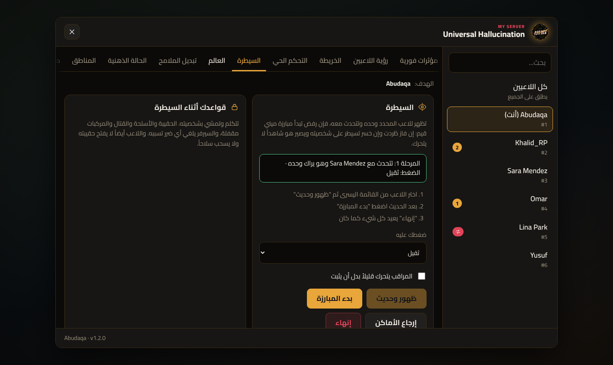
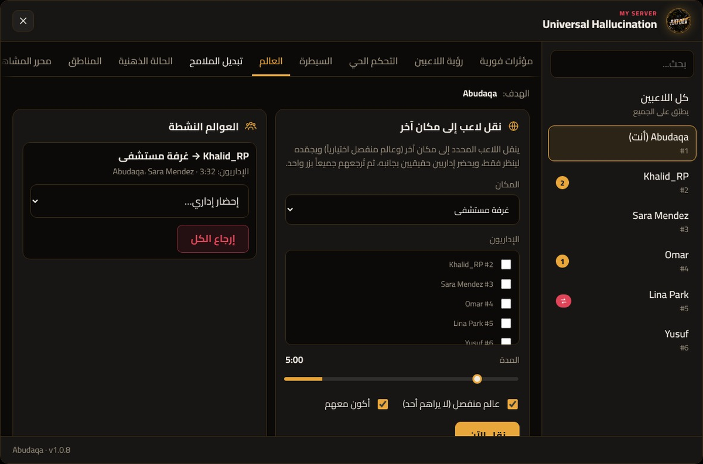

<div dir="rtl" align="right">

<div align="center">



# Universal Hallucination - سكربت هلوسة FiveM

**نظام هلوسة مجاني ومفتوح المصدر لرول بلاي FiveM وفعاليات الإدارة.**
زومبي، أشباح، عين عملاقة تراقبك، ألعاب مقاومة، مناطق مسكونة، محرر مشاهد، سيطرة على شخصية لاعب، ولوحة تحكم كاملة.
يعمل مع **ESX وQBCore وQbox (QBX) وstandalone وأي فريمورك مخصص**. عربي وإنجليزي (واجهة RTL).

   

Ra7 DEV · Dev by: Abudaqa · [ديسكورد](https://discord.gg/Zk5CrhHYe) · رخصة MIT (مجاني)

[English](README.md) · [التحميل](https://github.com/Abudaqa-DEV/RA7Universal-Hallucination/releases/latest) · [لماذا](#لماذا-هذا-السكربت) · [التركيب](#التركيب) · [سطر واحد للربط](#اربطه-من-أي-سكربت-بسطر-واحد) · [المقارنة](#مقارنة-صريحة) · [الأسئلة](#أسئلة-شائعة) · [سجل التغييرات](CHANGELOG.md)



</div>

51 نوع هلوسة، 17 سيناريو جاهز، 6 مشاهد من الماضي والحاضر، محرر مشاهد، مناطق مسكونة، نظام توتر نفسي، تحكم حي بشخص وهمي،
سيطرة على لاعب ومبارزة، عالم موازٍ، ألعاب مقاومة، ولوحة تحكم كاملة. يعمل بدون فريمورك أو مع ESX / QBCore / Qbox / نظامك.

> **صراحة:** الكود مُختبر ببيئة FiveM وهمية (**419 فحصاً للسيرفر و231 للكلاينت** كلها ناجحة) مع فحص ثابت (lint) و**مطابقة الأسماء
> مع المراجع الرسمية للمجتمع** (كل الـ 139 native المستخدمة موجودة في [citizenfx/natives](https://github.com/citizenfx/natives)،
> وكل موديل وجزيء وحزمة ضرر وتايم سايكل موجود في [gta-v-data-dumps](https://github.com/DurtyFree/gta-v-data-dumps)).
> لكنه **لم يُشغَّل على سيرفر FiveM حقيقي** من طرفي. تبويب **التشخيص** يعرض ما ينقص نسختك، وبطاقة **الموثوقية** تقول *لماذا* لم تعمل هلوسة.
> جرّبه على سيرفر تجريبي أولاً. الأصوات مصنوعة خصيصاً ويمكنك استبدال أي ملف في `html/assets/sounds/`.

## لماذا هذا السكربت
أغلب هلوسات رول بلاي FiveM (مخدرات، صدمة، جنون، أحداث رعب، قصص الإدارة) مجرد أنيميشن وفلتر شاشة، والإدارة لا تستطيع تشغيلها مباشرة.
**Universal Hallucination** يعطيك تأثيرات حقيقية شخصية تظهر عند اللاعب وحده، تشغّلها من لوحة أو من سكربت مخدرات/إسعاف أو من منطقة مسكونة:

| المشكلة في أغلب السيرفرات | ما يفعله السكربت |
|---|---|
| "الهلوسة ما اشتغلت" ولا أحد يعرف السبب | **الموثوقية:** كل تأثير يُراقَب، ويُسجَّل السبب (داخل مركبة، لا مكان فارغ، موديل ناقص، خطأ سكربت) ويظهر للإدارة، و**اختبار شامل** يجرّب كل الأنواع عليك، و**بديل مخيف** يعمل إن لم يظهر شيء |
| التأثير يبدأ واللاعب لا يستطيع فعل شيء | **«قاوم!» أولاً:** مرحلة تحذير تعطي اللاعب ثواني ليقاوم *قبل* أن يبدأ التأثير، ثم ألعاب مقاومة صعبة (4 مستويات) |
| السكربتات تعمل مع فريمورك واحد | ESX وQBCore وQbox / QBX وstandalone ومخصص؛ تُفهم الأسماء `qbx_core` و`qb-core` و`es_extended`؛ وفشل الجسر لا يوقف السكربت |
| التأثيرات كلها ضبابية مملة | زومبي بـ 16 شكلاً، أشباح، ظلال، حشرات، **عين عملاقة** و**جفون تفتح وتغلق**، لاق وهمي، جروح وهمية، إحساس الموت، صدى لك |
| الإدارة لا تستطيع إخراج حدث | تحكم حي، سيطرة، مبارزة، عالم موازٍ، محرر مشاهد، مناطق مسكونة، وخريطة بكل اللاعبين |
| إنجليزي فقط | عربي + إنجليزي في كل مكان (اللوحة والإشعارات وتعليقات الإعدادات) |

## الجديد في 1.3.0
- **الجمب سكير صار بيد (NPC) حقيقي وليس صورة.** يظهر بيد محلي لا يؤذي (زومبي/شبح بنفس الـ 16 شكلاً: جروح ودم وتعبير وجه) لهذا اللاعب فقط بثلاثة أنماط: **pop** (أمامك مباشرة يحدّق ثم ينقض)، **rush** (يركض نحوك من بعيد)، **behind** (خلفك، والصدمة عندما تلتفت)، مع وميض أبيض وصرخة وهزة كاميرا، ويختفي عند وصوله إليك. يعمل سيراً وداخل المركبة. وتستخدم ألعاب المقاومة نفس البيد. `Config.Jumpscare.Mode` = `'ped'` (الافتراضي) / `'image'` (الصور القديمة) / `'both'` ويمكن تغييره من تبويب الإعدادات. وإن تعذّر وضع بيد يظهر الوميض والصرخة والهزة بدون خطأ.
- اختبارات جديدة: 31 فحصاً للجمب سكير بالبيدات (المجموع 262 للعميل و419 للسيرفر)، وفحص أسماء المتغيرات والـ natives والموديلات يمر بالكامل.

## الجديد في 1.2.0
- **هلوسة العين** (`eyes`): الشاشة تصير عيناً تفتح وتغلق. **الشاشة نفسها تصير العين**: ترى العالم فقط من فتحة على شكل عين (زوايا مدببة، رموش، حواف حمراء) تفتح وترمش وتنغلق **كلها** (أسود تام مع نبض قلبك)، وتبقى مغلقة فترة، ثم تفتح تدريجياً حتى ترجع الشاشة كاملة. هذا هو الافتراضي (`Mode = 'lids'`)، ووضع `watcher` اختياري: عين عملاقة (بؤبؤ وبياض) في الظلام. مع صوت ومؤثرات، ومؤثر فوري (`eye_blink`) و**حدث في محرر المشاهد**.
- **السيطرة مطوّرة** (`Config.Takeover`): المتحكم يختار **ضغطه** (خفيف ← ساحق = صعوبة مقاومة اللاعب)؛ إن فاز اللاعب طُرد المتحكم، وإن خسر لعب المتحكم شخصيته وانتقل اللاعب لمكانه ليشاهد (ثابتاً، أو يمشي قليلاً إن اختار المتحكم ذلك). أثناء السيطرة **لا يفتح الحقيبة ولا يُخرج سلاحاً ولا يقاتل ولا يركب مركبة**، والسيرفر يلغي أي ضرر يسببه. الأمر `/hback` أو زر اللوحة **يُرجع الاثنين بالضبط لأماكنهما**.
- **الموثوقية** (`Config.Health`): لماذا لم تعمل الهلوسة لكل نوع في تبويب التشخيص، **اختبار شامل**، بديل مخيف، وتسجيل تلقائي للاعب لم يعلن جاهزيته. انتظار الفريمورك 20 ثانية بدل 120.
- **«قاوم!» قبل التأثير** (`Config.Resist.Onset`): مرحلة تحذير بنبض قلب وتعتيم، وأول دعوة بعد 4 ثواني بدل 30.
- **تبويب الخريطة:** كل اللاعبين مباشرة على خريطة، وأنشئ مناطق مسكونة بالضغط (أضف صورة أطلسك في `Config.Map`).
- **تبويب الإعدادات:** أهم الخيارات (مستوى المقاومة، الألوان، المفاتيح...) تُحفظ من اللوحة، مع تصدير واستيراد JSON.
- **أصوات رعب أقوى:** ضربة رعب وصرخة، نبض ثقيل، طنين مظلم (`tools/make_sounds.py`).
- **أنظمة أكثر:** الأسماء `qbx` و`qbx_core` و`qb-core` و`es_extended` مقبولة، وجسر فريمورك معطوب لا يوقف السكربت.
- لوجو دائري، إصلاح شريط المدة بالعربية (المقبض والشريط متطابقان)، ومطابقة الأسماء مع القوائم الرسمية.

<div align="center">
 
 
</div>

## اربطه من أي سكربت بسطر واحد
```lua
-- سكربت مخدرات / إسعاف / وظيفة / حدث (server side)
exports.universal_hallucination:Start(source, 'zombie_horde', { duration = 60, intensity = 0.8 })
exports.universal_hallucination:RunScenario(source, 'paranoia')
exports.universal_hallucination:AddStress(source, 25)
```
القائمة الكاملة للـ exports والأحداث في [docs/INTEGRATION_GUIDE.md](docs/INTEGRATION_GUIDE.md).

## يعمل مع
| الفريمورك | الإعداد (`Config.General.Framework`) | ملاحظات |
|---|---|---|
| تلقائي | `'auto'` (الافتراضي) | يختار Qbox أو QBCore أو ESX إن كان يعمل، وإلا standalone |
| Standalone | `'standalone'` | بدون أي اعتماد |
| ESX | `'esx'` (`es_extended`) | الوظيفة + كشف الموت |
| QBCore | `'qbcore'` (`qb-core`) | الوظيفة + البيانات (موت / تقييد / سجن) |
| Qbox (QBX) | `'qbox'` (`qbx`, `qbx_core`) | |
| مخصص | `'custom'` | عبّئ `bridge/custom.lua` |

## مقارنة صريحة
(فئات وليست أسماء سكربتات بعينها.)

| | سكربتات فلتر الشاشة | سكربتات تأثير واحد | **Universal Hallucination** |
|---|---|---|---|
| أنواع التأثير | 1 إلى 3 | 1 إلى 5 | **51** (كائنات، بصري، صوتي، جسدي، لاعبون) |
| اللاعب يقاوم | لا | نادراً | **نعم: مرحلة تحذير + 4 مستويات** |
| الفريمورك | غالباً واحد | غالباً واحد | **ESX وQBCore وQbox وstandalone ومخصص** |
| لوحة إدارة بدون أوامر | لا | لا | **نعم، مع خريطة ومحرر مشاهد وإعدادات** |
| تخبرك لماذا فشل | لا | لا | **نعم (الموثوقية + الاختبار الشامل)** |
| أحداث بتوجيه الإدارة | لا | لا | **تحكم حي، سيطرة، مناطق** |
| واجهة عربية | لا | لا | **نعم (RTL)** |
| آمن بالتصميم (ضرر 0، محلي فقط) | — | يختلف | **نعم، ومفحوص بالاختبارات** |

## الأمان
- كل شيء يظهر **عند الهدف فقط** (بيدات محلية غير مشبكة)، لا يراه غيره.
- لا شيء يؤذي اللاعب: الرصاص ضرره 0، المطلقون **بدون ذخيرة**، وقبل كل رصاصة يُفحص مسارها: يجب أن يبعد عن الرأس والصدر
  والقدم مسافة لا تقل عن `Config.Realism.Gunfire.MinMiss` (ولا أقل من متر)، وإلا لا تُطلق.
- "إحساس الموت" لا يقتل أبداً: ينتهي بإغماء ثم استيقاظ. الجروح الوهمية بصرية فقط.
- السيرفر هو الحَكَم: الصلاحيات، تفعيل الأنواع، الحدود، عدد الجلسات، الاستثناء الذاتي ومعدلات الطلب، وكل ما ترسله اللوحة يُفحص من جديد.
- بدون تتبع أو أكواد عن بعد أو أوامر مخفية.

## ما بداخله
| الفئة | الأنواع |
|---|---|
| كائنات | شبح، ظل، متعقّب، جمهور، **جيش زومبي**، حيوانات، مسلّح، **اشتباك**، **مشهد**، قرين، **صدى**، صديق وهمي |
| بصري | تشوه، رحلة مخدرات، رؤية نفقية، رؤية مزدوجة، وميض، حشرات الشاشة، **حشرات حقيقية**، دم، كلمات، لون، اهتزاز كاميرا، إبطاء وقت، إشعارات مزيفة، **غرق** |
| صوتي | دقات قلب، تنفس، همسات، خطوات خلفك، طرق، رنين هاتف، تشويش، طنين، صندوق موسيقى، رنين أذن، طلقات بعيدة |
| جسدي | رعشة سلاح، رعشة يد، دوخة، **إحساس الموت**، **تحوّل لزومبي**، **انهيار**، **سكران**، **لاق وهمي**، **جروح وهمية** |
| لاعبون | إخفاء لاعب، ظهور لمشاهد واحد، سيطرة، رؤية الأشباح |

### أبرز الميزات
- **كل شيء من اللوحة بدون أوامر** (الأوامر موجودة أيضاً ويمكن تغيير أسمائها أو إيقافها).
- **المناطق المسكونة:** قف في مكان واضغط "إنشاء هنا"، وكل من يدخل المنطقة تبدأ له الهلوسة (احتمال، راحة، نصف قطر، شدة).
- **الحالة الذهنية:** عداد توتر دائم لكل شخصية؛ الموت والإصابة والهلوسة ترفعه، والوقت يخفضه، وكلما ارتفع زادت الهلوسات التلقائية. المعالج النفسي يخفضه من اللوحة، والسكربتات الأخرى تستخدم `AddStress` و`ReduceStress`.
- **محرر المشاهد:** أضف ممثلين، اسحبهم على الخريطة، اكتب حوارهم وحركاتهم، اختر الفلتر والطقس والساعة، جرّب على نفسك واحفظ. بدون كود.
- **السيطرة:** تظهر للاعب وحده وتتكلم معه ثم مبارزة ميني جيم بضغط تختاره؛ إن خسر تأخذ مكانه (بلا حقيبة ولا سلاح ولا قتال ولا مركبات) ويبقى هو يشاهد. `/hback` يُرجع كل شيء.
- **العالم الموازي:** انقل لاعباً لمكان آخر (في عالم خاص به)، متجمد يستطيع النظر فقط، وأحضر إداريين حقيقيين بجانبه، ثم أرجع الجميع بزر واحد.
- **واقعية:** اشتباكات رصاصها يخطئ دائماً، زومبي بأنماط متعددة، حشرات حقيقية، إحساس الموت، صدى لك يمشي على خطواتك القديمة، لاق وهمي، صوت مايك لمايك.
- **التشخيص:** زر واحد يفحص كل موديل وأنيميشن وجزيء وسلاح في إعداداتك داخل اللعبة.
- **تشغيل وإيقاف أي هلوسة** من `Config.Switches`.

<div align="center">
 
 
</div>

## سابقاً: 1.1.0
- **المقاومة صارت صعبة** (`Config.Resist.Level = 'hard'`؛ المستويات `easy` / `normal` / `hard` / `nightmare`): سلسلة ألعاب مختلفة متتالية، ورعب مفاجئ يضربك وسط اللعبة، وأسهم مخفية، وقلوب أرواح. وزر «قاوم!» بتصميم جديد.
- **انتهت الجمجمة**: وجوه رعب واقعية للزومبي (`html/assets/scare/` وتقدر تضيف صورك في `Config.Jumpscare.Images`) مع 14 وجهاً مرسوماً احتياطياً.
- **16 شكل زومبي** في `Config.Realism.Zombies.Looks` (بنت الشعر الطويل، العروس، المحروق، الزاحف، بلا ملامح، الكلب...).
- كتلة «ابدأ من هنا» بالعربي والإنجليزي أعلى `config.lua`: server.cfg، الصلاحيات، كيف تصير أدمن، أول تشغيل.
- الإشعارات كانت تُحذف بصمت - تم إصلاحها. التفاصيل في [CHANGELOG](CHANGELOG.md).

<div align="center">
<br>
 
</div>

> (ابتداءً من 1.3.0 الجمب سكير بيد حقيقي افتراضياً؛ الصور تُستخدم فقط مع `Config.Jumpscare.Mode = 'image'` أو `'both'`.) صور الرعب المرفقة مأخوذة من بوستر زومبي Ra7 DEV الذي قدّمه صاحب المشروع. لو بدّلتها بصورك أبقِ الأسماء نفسها أو عدّل `Config.Jumpscare.Images`.

## التركيب
1. نزّل `universal_hallucination-x.y.z.zip` من [آخر إصدار](https://github.com/Abudaqa-DEV/RA7Universal-Hallucination/releases/latest) وضع المجلد `universal_hallucination` في `resources/`.
   **اسم المجلد يجب أن يكون `universal_hallucination` بالضبط.** إن نزّلته بـ "Code ← Download ZIP" أو `git clone` سيكون اسمه `RA7Universal-Hallucination(-main)`: غيّر اسمه (أو استنسخه هكذا: `git clone https://github.com/Abudaqa-DEV/RA7Universal-Hallucination.git universal_hallucination`) وإلا ستفشل الـ exports وأمر `ensure`.
2. في `server.cfg`:
```
ensure universal_hallucination
add_ace group.admin universal_hallucination.use allow
add_ace group.admin universal_hallucination.director allow
add_ace group.admin universal_hallucination.swap allow
add_ace group.admin universal_hallucination.admin allow
```
3. افتح `config.lua` وحدّد اللغة والاسم والألوان والفريمورك، ثم أعد التشغيل.
4. داخل اللعبة افتح `/hmenu` ← تبويب **التشخيص** ← شغّل الفحص مرة واحدة.

المتطلبات: OneSync وإصدار سيرفر حديث (Lua 5.4). اختياري: pma-voice / mumble / saltychat (ميزات الصوت)، illenium-appearance / fivem-appearance (تبديل الملامح).

| الصلاحية | تسمح بـ |
|---|---|
| `.use` | تشغيل وإيقاف الهلوسات والسيناريوهات والمؤثرات واللوحة |
| `.director` | التحكم الحي، السيطرة، العالم الموازي، أدوات التوتر |
| `.swap` | تبديل الملامح والأغراض |
| `.admin` | المناطق، محرر المشاهد، التشخيص، الأماكن، تجاوز الاستثناء الذاتي |

## كل شيء في `config.lua`
الاسم والألوان والنصوص واللغة والأوامر والصلاحيات، ولكل نوع مدته وشدته وموديلاته وأصواته، والسيناريوهات والمشاهد والمؤثرات
والمناطق ومستويات التوتر والأماكن والصوت والسيطرة وحدود الأمان. لكل قيمة شرح بالعربي (التعليقات داخل الملف بالعربية) ونطاقها وافتراضيها.
التفاصيل في [docs/CONFIGURATION.md](docs/CONFIGURATION.md).

```lua
Config.Switches = {
    Categories = { audio = false },     -- يطفئ كل الأنواع الصوتية
    Types      = { ghost = false },     -- يطفئ نوعاً واحداً
    Scenarios  = { paranoia = false },
}
```

**ألوانك في كتلة واحدة.** الافتراضي ألوان لوجو Ra7 DEV (أسود وذهبي). غيّر `Config.Brand.Colors` فتتغير اللوحة والحوار والمؤثرات كلها، وفي الملف مجموعات ألوان جاهزة. ضع لوجو سيرفرك في `Config.Brand.Logo` (أو `''` لإخفائه).


## الأوامر (كلها اختيارية)
| الأمر | الوظيفة |
|---|---|
| `/hmenu` | لوحة التحكم |
| `/halluc <id\|me> <النوع> [ثواني] [شدة]` | تشغيل نوع |
| `/hscenario <id\|me> <الاسم>` | سيناريو بتوقيت |
| `/hscene <id\|me> <المشهد> [ثواني]` | مشهد من `Config.Scenes` |
| `/hstop`, `/hlist` | إيقاف، قائمة |
| `/hhide` `/hsolo` `/hghost` | إخفاء لاعب عن مشاهدين / لا يراه إلا مشاهد واحد / لاعبون شفافون |
| `/hdirect` `/hsay` `/hr` | تحكم حي بشخص وهمي، كلامه، رد الهدف |
| `/happear <id>` | تظهر بشخصيتك للاعب واحد فقط |
| `/hpossess <id>` `/hunpossess` | يرى اللاعب بعينيك ويتجمد ويصمت وأنت تتكلم عنه |
| `/hvoice <id>` | تشغيل/إيقاف صوت مايك لمايك |
| `/htake <id> [easy\|normal\|hard\|nightmare] [move]` `/hseize` `/hrelease` `/hback` | السيطرة: حديث (والضغط، وmove ليمشي المراقب)، مبارزة، إنهاء، **إرجاع الاثنين لأماكنهما قبل التبديل** |
| `/hcue` `/hadjust` | مؤثر فوري، تغيير الشدة مباشرة |
| `/hswap` `/hrestore` `/hcarry` | تبديل الملامح (يحتاج نظام ملابس)، إرجاع، نقل أغراض |
| `/hoff` | اللاعب يوقف استقبال هلوسات الأوامر |

زر المقاومة `G` (يتغير من `Config.Resist`). أسماء الأوامر كلها قابلة للتغيير من `Config.Commands`.
الربط مع سكربتات أخرى (مخدرات، إسعاف، وظائف): [docs/INTEGRATION_GUIDE.md](docs/INTEGRATION_GUIDE.md).

## تحذيرات — اقرأها قبل التركيب
1. **لم يُجرَّب على سيرفر FiveM حقيقي بعد** (اختبارات محاكاة فقط). ركّبه على سيرفر تجريبي أولاً وخذ نسخة احتياطية قبل السيرفر الحقيقي.
2. **أضواء وامضة ومفاجآت مخيفة.** `flicker` والمؤثرات `jumpscare` / `blackout` / `glitch` / `blood_rain` ونبض اللون `tint` ووميض الزومبي قد تضر أو تزعج من لديهم حساسية للضوء (صرع ضوئي). أطفئها من `Config.Switches` إن احتاج مجتمعك ونبّه لاعبيك.
3. **نبّه لاعبيك.** الهلوسة والسيطرة والعالم الموازي تعمل على لاعبين حقيقيين. ضعها في قوانين السيرفر؛ ويمكن للاعب إيقاف هلوسات الأوامر عنه بـ `/hoff`.
4. **الصلاحيات قوية.** `.director` و`.admin` تسمح بالسيطرة والعالم الموازي والمناطق ومحرر المشاهد. لا تعطها للاعبين العاديين أبداً.
5. **أسماء من الذاكرة.** قد لا توجد بعض الموديلات والأنيميشن والجزيئات في نسختك. شغّل **التشخيص** من اللوحة وصحّح الأسماء المذكورة في `config.lua`.
6. **السيطرة** (قفل الحقيبة يعمل تلقائياً مع ox_inventory وqb-inventory، ولغيرها استخدم `Custom.Takeover.Inventory`) **بصرية:** تبدّل الملامح والمكان فقط، وليس هوية الفريمورك (الاسم والوظيفة والحقيبة).
7. الصوت وتبديل الملامح والطقس تعتمد على سكربتات أخرى عندك؛ راجع [حدود معروفة](#حدود-معروفة).

## ساعدنا نتطور
المشروع مجاني، وأكبر مساعدة الآن هي **التجربة على سيرفرات حقيقية**.
- **شغّل تبويب التشخيص** (`/hmenu` ← التشخيص) و[أرسل لنا قائمة](https://github.com/Abudaqa-DEV/RA7Universal-Hallucination/issues/new?template=test_report.md) الأسماء غير الموجودة في نسختك. هذا أهم بلاغ ممكن.
- **بلّغ عن الأخطاء** بـ[قالب الخطأ](https://github.com/Abudaqa-DEV/RA7Universal-Hallucination/issues/new?template=bug_report.md): ماذا حدث، ماذا توقعت، الفريمورك، الإصدار، مخرجات الكونسول (السيرفر + F8).
- **اقترح أفكاراً** بـ[قالب الاقتراح](https://github.com/Abudaqa-DEV/RA7Universal-Hallucination/issues/new?template=feature_request.md) أو في [الديسكورد](https://discord.gg/Zk5CrhHYe).
- **شاركنا مشاهد وسيناريوهات ومناطق وترجمات** (ملف `locales/xx.lua` جديد) أو افتح Pull Request. التفاصيل في [CONTRIBUTING.md](CONTRIBUTING.md).
- **ضع نجمة ⭐ للمستودع** وعرّف به سيرفرات أخرى، وأبقِ سطر الحقوق (الرخصة تشترط ملف الرخصة فقط، وسطر الحقوق نقدّره).

## التوثيق
[التركيب](docs/INSTALLATION.md) · [الإعدادات](docs/CONFIGURATION.md) · [الربط](docs/INTEGRATION_GUIDE.md) · [حل المشاكل](docs/TROUBLESHOOTING.md) · [البنية](docs/ARCHITECTURE.md)

## حقوق
الخط: Cairo (رخصة SIL OFL 1.1) داخل `html/assets/fonts/`.

## حدود معروفة
- الهلوسة رسم على جهاز اللاعب؛ كلاينت معدّل يستطيع تجاهل التأثير على نفسه فقط.
- نتيجة المقاومة يرسلها الكلاينت؛ السيرفر يتحقق من الجلسة والزمن الأدنى والتبريد والمعدل فقط.
- السيطرة تبدّل الملامح والمكان فقط، **وليس** هوية الشخصية داخل الفريمورك (الاسم والوظيفة والحقيبة).
- تبديل الملامح ومظهر السيطرة يحتاجان نظام ملابس (illenium-appearance / fivem-appearance / مخصص)، وبدونه تكون السيطرة بالكاميرا فقط.
- عزل الصوت وصوت مايك لمايك يعتمدان على نظام الصوت عندك؛ إن اختلفت الأسماء استخدم `Provider = 'custom'`.
- تغيير الوقت/الطقس محلياً في المشاهد قد يتعارض مع سكربتات الطقس (عطّله بـ `Config.Types.scene.Environment = false`).
- إحداثيات الأماكن الجاهزة في `Config.Places` تقريبية؛ عدّلها أو احفظ أماكنك من اللوحة.
- آثار الجروح الوهمية تُرسم على شخصية اللاعب نفسه، وهل يراها غيره يعتمد على نسخة اللعبة.


## أسئلة شائعة
**هل يعمل مع ESX / QBCore / Qbox؟** نعم، وكذلك standalone ومخصص. اترك `Config.General.Framework = 'auto'`.

**الهلوسة لا تظهر، ماذا أفعل؟** افتح `/hmenu` ← **التشخيص**: بطاقة الموثوقية تذكر السبب لكل نوع، وزر **اختبار شامل** يجرّب كل الأنواع عليك. انظر [docs/TROUBLESHOOTING.md](docs/TROUBLESHOOTING.md).

**هل تؤذي اللاعب؟** لا. الرصاص ضرره 0 والمطلقون بلا ذخيرة، وإحساس الموت ينتهي بإغماء ثم استيقاظ.

**هل يستطيع اللاعب مقاومتها؟** نعم: «قاوم!» يظهر قبل التأثير وأثناءه، بأربع ألعاب وأربعة مستويات صعوبة.

**هل أستطيع ربطه بسكربت المخدرات عندي؟** نعم بسطر واحد (`exports.universal_hallucination:Start`). راجع [دليل الربط](docs/INTEGRATION_GUIDE.md).

**هل هو مجاني؟** نعم، رخصة MIT.

**الكلمات المفتاحية:** سكربت هلوسة FiveM، هلوسة رول بلاي، زومبي FiveM، سكربت رعب FiveM، لوحة إدارة FiveM، سكربت مخدرات هلوسة، ESX، QBCore، Qbox.

</div>
