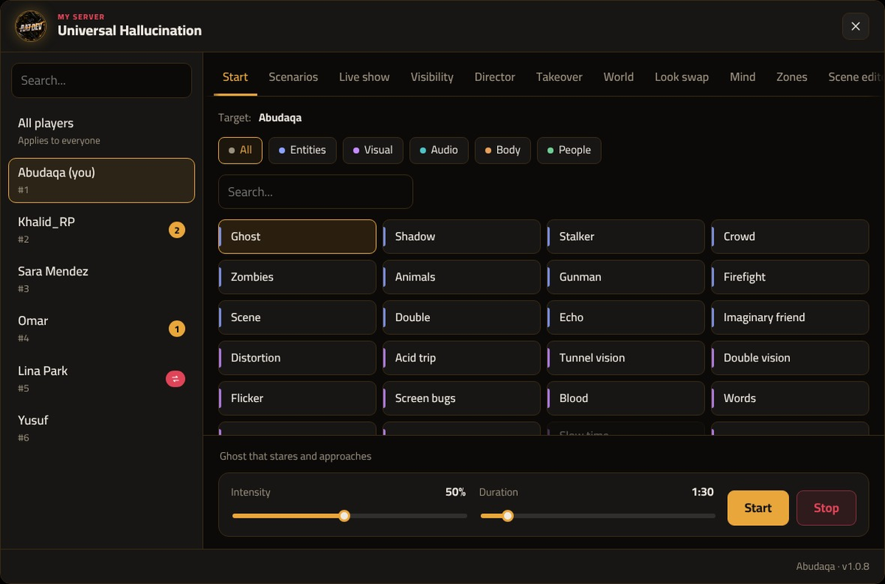
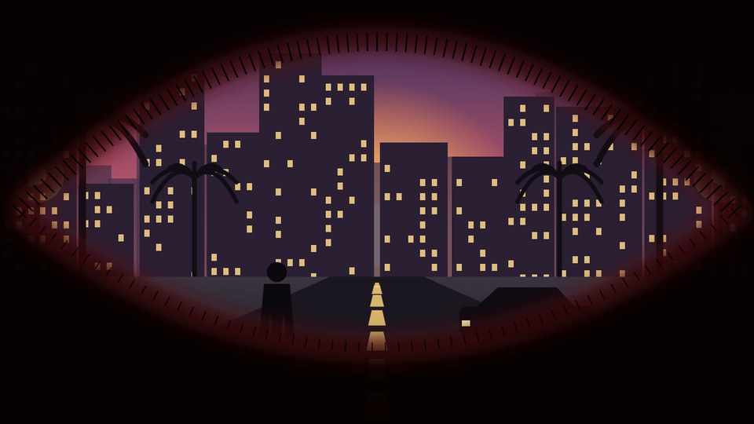
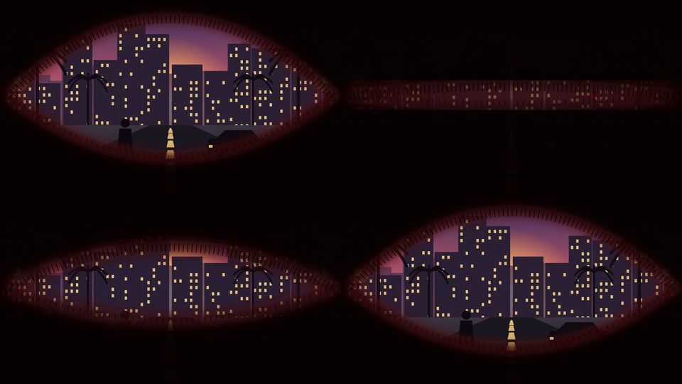
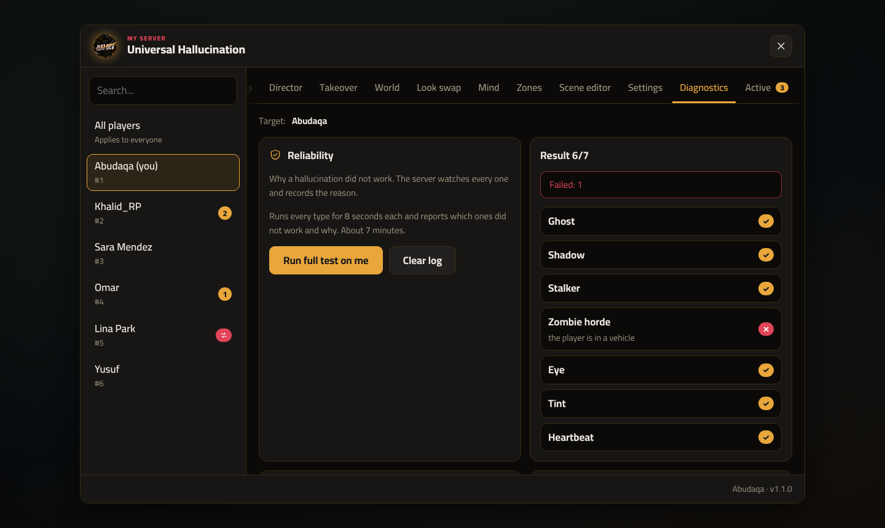
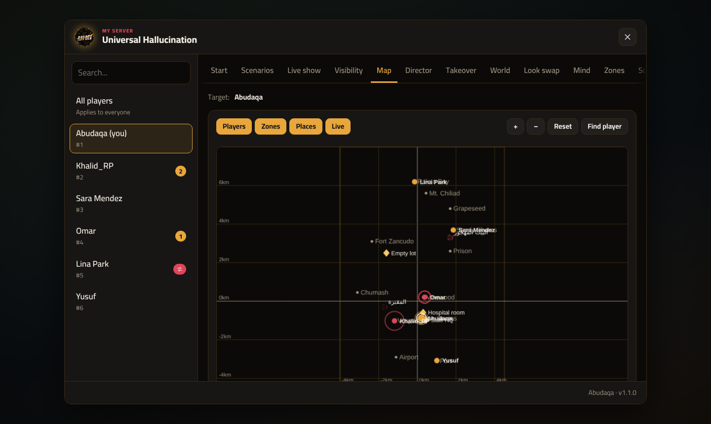
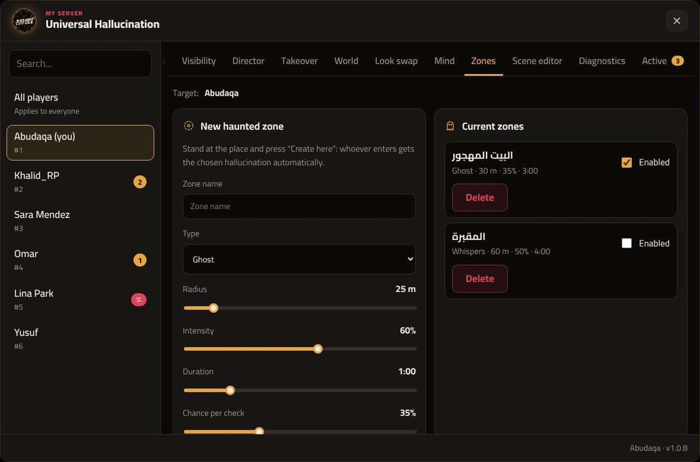
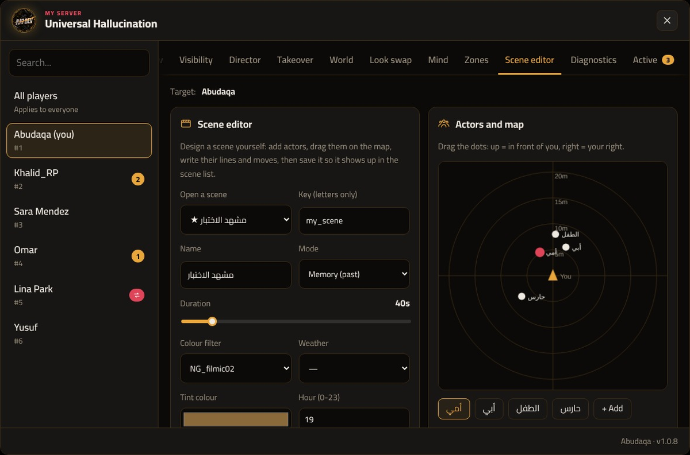
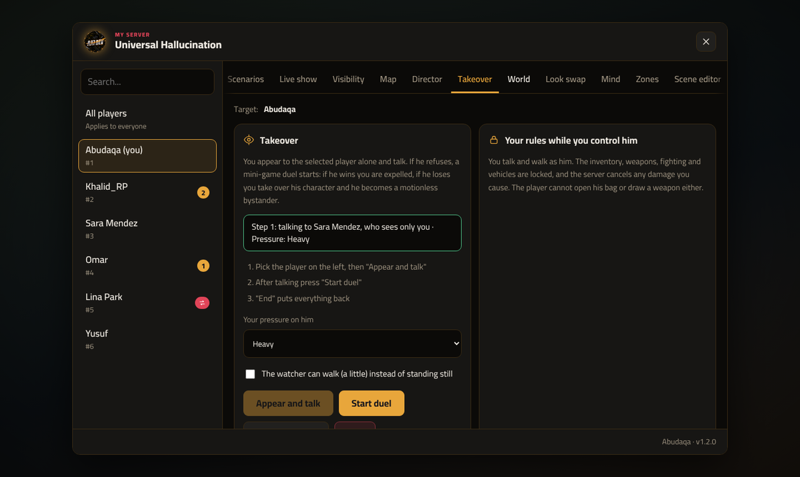
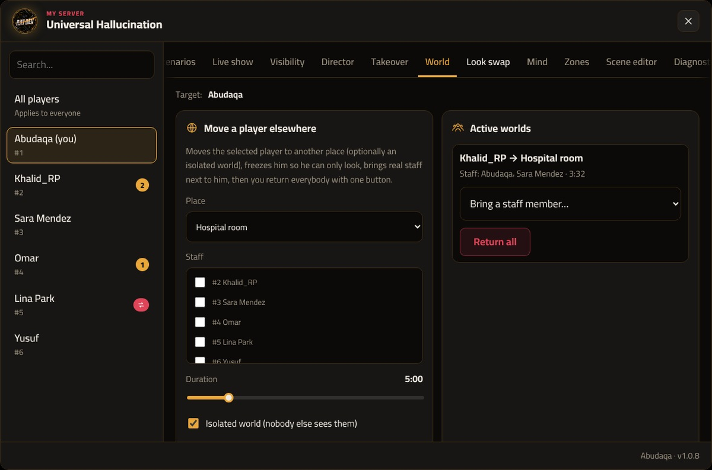

<div align="center">


# Universal Hallucination - FiveM Hallucination Script

**Free, open-source hallucination system for FiveM roleplay and staff events.**
Zombies, ghosts, a giant watching eye, resist mini-games, haunted zones, a scene editor and a full admin panel.
Works with **ESX, QBCore, Qbox (QBX), standalone and custom frameworks**. Arabic and English.

    

Ra7 DEV · Dev by: Abudaqa · [Discord](https://discord.gg/Zk5CrhHYe) · MIT license (free)

[العربية](README.ar.md) · [Download](https://github.com/Abudaqa-DEV/RA7Universal-Hallucination/releases/latest) · [Why](#why-this-script) · [Install](#install) · [Use it in one line](#use-it-from-another-script-in-one-line) · [Compare](#how-it-compares) · [FAQ](#faq) · [Changelog](CHANGELOG.md)



</div>

51 hallucination types, 17 ready scenarios, 6 scenes from the past and the present, a scene editor, haunted zones,
a stress system, live puppeting of imaginary people, possession, a takeover duel, a parallel-world tool, resist
mini-games and a full admin panel. Arabic and English. Works standalone or with ESX, QBCore, Qbox or your own framework.

> **Honest status.** The code is tested with a mock FiveM environment (**419 server checks and 231 client checks** pass),
> plus an offline lint and a **names check against the community references** (all 139 natives used exist in
> [citizenfx/natives](https://github.com/citizenfx/natives); every ped model, particle, damage pack and timecycle in the
> config exists in [gta-v-data-dumps](https://github.com/DurtyFree/gta-v-data-dumps)). It has **not** been run in a real
> FiveM server by the author. The **Diagnostics** tab shows what is missing on your build and the new **Reliability** card tells you
> *why* a hallucination did not work. Test on a development server first.
> Sounds are original and synthesized (replace any file in `html/assets/sounds/`).

## Why this script
Hallucinations in FiveM roleplay (drugs, trauma, sanity, horror events, staff-run storylines) are usually faked with an animation and a screen filter,
and staff cannot run them live. **Universal Hallucination** gives you real, personal, local-only effects that you can start from a panel, from a drug or medical script, or from a haunted zone:

| Problem on most servers | What this script does |
|---|---|
| "The hallucination did nothing" and nobody knows why | **Reliability**: every effect is watched; the reason (in a vehicle, no free spot, missing model, script error) is logged and shown to admins, a **full self-test** runs every type on you, and a **fallback scare** runs if nothing appeared |
| The effect starts and the player cannot do anything about it | **RESIST! comes first**: a warning phase gives the player a few seconds to fight it off *before* it starts, then hard mini-games (4 levels) |
| Scripts only work with one framework | ESX, QBCore, Qbox / QBX, standalone and custom; names like `qbx_core`, `qb-core`, `es_extended` are understood; a broken adapter never blocks the script |
| Effects are the same dull blur | Zombies in 16 forms, ghosts, shadows, insects, a **giant eye** and **eyelids that open and close**, fake lag, phantom wounds, death feeling, echo of yourself |
| Staff cannot direct events | Live puppeting, possession, takeover duel, parallel world, scene editor, haunted zones, a map with every player |
| Only English | Arabic + English everywhere (panel, notifications, config comments), RTL panel |

## New in 1.3.0
- **The jump scare is a real ped (NPC), not a picture.** A local, harmless zombie/ghost ped (the same 16 looks, with wounds, blood and mood) appears for ONE player only: **pop** (right in front, stares, then lunges), **rush** (sprints at you from far away) or **behind** (the scare lands when you turn around), with a white flash, the scream and a camera kick, and it vanishes when it reaches you. Works on foot and in a vehicle. The resist-game spikes use the same ped. `Config.Jumpscare.Mode` = `'ped'` (default) / `'image'` (the old pictures) / `'both'`, also switchable from the Settings tab. If no ped can be placed the scare still lands (flash + scream + shake).
- New tests: 31 checks for the ped jump scare (262 client + 419 server in total), a lowercase-global scan and the native / model name check all pass.

## Earlier: 1.2.0
- **Eye hallucination** (`eyes`): the screen becomes an eye that opens and closes. **The screen itself becomes the eye**: you only see the world through an eye-shaped opening (pointed corners, lashes, blood-shot rim) that opens, blinks, sinks shut until it is **completely closed** (black, heartbeat), stays shut for a while, then opens again until the whole screen is back. That is the default (`Mode = 'lids'`); `watcher` is an optional giant eye (iris and pupil) in the dark. Sound and effects included. Also a cue (`eye_blink`) and a **scene-editor event**.
- **Reliability** (`Config.Health`): why a hallucination did not work, per type, in the Diagnostics tab; a **full self-test**; a fallback scare; automatic registration of a player whose client never said "ready"; the framework wait is 20 s instead of 120 s (`Config.General.ReadyTimeout`).
- **RESIST! before the effect** (`Config.Resist.Onset`): a warning phase with a heartbeat and dark edges; the first prompt appears after 4 s instead of 30 s.
- **Takeover, upgraded** (`Config.Takeover`): the controller picks his *pressure* (light to crushing = how hard the player's resist games are); win = he is expelled, lose = he plays the player's character while the player is moved to his place and watches (frozen, or free to walk a little if the controller chooses). While controlling he **cannot open the inventory, draw a weapon, fight or enter a vehicle**, and the server cancels any damage he causes. `/hback` or the panel button puts **both back exactly where they stood**.
- **Map tab**: every player live on a GTA-style map, create haunted zones by clicking (add your own atlas image, `Config.Map`).
- **Settings tab**: the main options (resist level, colours, switches...) are saved by the server from the panel; export / import JSON.
- **Stronger horror sounds**: new jump-scare hit + scream, heavy heartbeat, dark drone (`tools/make_sounds.py`).
- **More frameworks:** `qbx`, `qbx_core`, `qb-core`, `es_extended` are accepted names; a failing framework adapter can no longer block the script.
- Round logo icon, a fixed duration slider in Arabic (the knob and the bar now agree), checks against official native / model lists.

<div align="center">
 
 
</div>

## Use it from another script in one line
```lua
-- server side: drug, medical, job or event scripts
exports.universal_hallucination:Start(source, 'zombie_horde', { duration = 60, intensity = 0.8 })
exports.universal_hallucination:RunScenario(source, 'paranoia')
exports.universal_hallucination:AddStress(source, 25)
```
All exports and events: [docs/INTEGRATION_GUIDE.md](docs/INTEGRATION_GUIDE.md).

## Works with
| Framework | Setting (`Config.General.Framework`) | Notes |
|---|---|---|
| Auto | `'auto'` (default) | picks Qbox, QBCore or ESX if started, else standalone |
| Standalone | `'standalone'` | no dependency |
| ESX | `'esx'` (`es_extended`) | job + death detection |
| QBCore | `'qbcore'` (`qb-core`) | job + metadata (dead / cuffed / jailed) |
| Qbox (QBX) | `'qbox'` (`qbx`, `qbx_core`) | |
| Custom | `'custom'` | fill in `bridge/custom.lua` |

## How it compares
Compared with the usual kinds of hallucination scripts (a screen filter, or a single spawned ped):

| | Screen-filter scripts | Single-effect scripts | **Universal Hallucination** |
|---|---|---|---|
| Effect types | 1 to 3 | 1 to 5 | **51** (entities, visual, audio, body, people) |
| Player can resist | no | rarely | **yes: warning phase + 4 difficulty levels** |
| Frameworks | usually one | usually one | **ESX, QBCore, Qbox, standalone, custom** |
| Admin panel (no commands) | no | no | **yes, with map, scene editor, settings** |
| Tells you why it failed | no | no | **yes (Reliability + self-test)** |
| Staff-directed events | no | no | **live puppeting, possession, takeover, zones** |
| Arabic UI | no | no | **yes (RTL)** |
| Safe by design (damage 0, local-only) | n/a | varies | **yes, checked by tests** |

(Categories, not named products: check the script you use today.)

## Safety by design
- Everything is drawn **locally on the target's client** (peds are not networked). Other players do not see it.
- Nothing can hurt the player. Bullets have `damage = 0`, shooters have **0 ammo**, and every bullet line is checked
  before it is fired: it must pass at least `Config.Realism.Gunfire.MinMiss` (never below 1.0 m) from the head, chest and feet.
- "Near-death" never kills. It ends with a faint and a wake-up. Phantom wounds are visual only.
- The server is the only authority: permissions, enabled types, clamps, concurrency, opt-out and rate limits.
  Everything the panel sends is re-validated on the server.
- No telemetry, no remote code, no hidden commands.

## What is inside
| Group | Types |
|---|---|
| Entities | ghost, shadow, stalker, crowd, **zombie_horde**, animals, gunman, **gunfight**, **scene**, double, **echo**, friend |
| Visual | distortion, acid_trip, tunnel_vision, double_vision, flicker, bugs, **insects**, blood, words, tint, camera_sway, time_slow, fake_notify, **underwater** |
| Audio | heartbeat, breathing, whispers, footsteps_behind, knocking, phone_ring, static_noise, drone, music_box, tinnitus, distant_gunshots |
| Body | weapon_tremor, hand_tremor, dizzy, **death_feeling**, **self_zombie**, **collapse**, **drunk**, **fake_lag**, **fake_wounds** |
| People | hide_player, solo_visible, possess, ghost_vision |

### Highlights
- **Everything from the panel, no commands needed** (commands exist too and can be renamed or turned off).
- **Haunted zones** - stand somewhere, press "Create zone here"; everybody who enters gets the chosen hallucination (chance, rest time, radius, intensity).
- **Mind / stress** - a persistent stress counter per character. Death, injuries and hallucinations raise it, time calms it, and the higher it is the more automatic hallucinations start. Psychologists lower it from the panel; other scripts use `AddStress` / `ReduceStress`.
- **Scene editor** - add actors, drag them on a map, write their lines and moves, pick the filter/weather/hour, test on yourself and save. No code.
- **Takeover** - appear to one player, talk, start a duel mini-game; if he loses you take his place and he is frozen watching. Everything is restored at the end.
- **Parallel world** - send a player to another place (own routing bucket), frozen so he can only look, bring real staff next to him, return everybody with one button.
- **Real-feeling effects** - gunfights with bullets that miss, zombies with several behaviours, real insects, death feeling, an echo of yourself walking your old path, fake lag, mic-to-mic voice.
- **Diagnostics** - one button checks every model / clip set / animation / particle / weapon in your config inside the game.
- **Turn any hallucination on/off** from `Config.Switches`.

<div align="center">
 
 
</div>

## Earlier: 1.1.0
- **Resist is hard now** (`Config.Resist.Level = 'hard'`; `easy` / `normal` / `hard` / `nightmare`): chains of different mini-games, scares that hit you mid-game, hidden arrow sequences, hearts. New "RESIST!" prompt.
- **No more skull jump scare**: realistic zombie images (`html/assets/scare/`, add your own in `Config.Jumpscare.Images`) with 14 drawn faces as fallback.
- **16 zombie forms** in `Config.Realism.Zombies.Looks` (ghost girl, bride, burnt, crawler, faceless, hound...).
- A bilingual "Start here" block at the top of `config.lua`: server.cfg, ACE permissions, becoming an admin, first run.
- Notifications were being dropped silently - fixed. See [CHANGELOG](CHANGELOG.md).

<div align="center">
<br>
 
</div>

> (Since 1.3.0 the jump scare is a real ped by default; the images below are used only with `Config.Jumpscare.Mode = 'image'` or `'both'`.) The bundled scare images come from the Ra7 DEV zombie poster supplied by the project owner. If you replace them with your own, keep the same file names or edit `Config.Jumpscare.Images`.

## Install
1. Download `universal_hallucination-x.y.z.zip` from the [latest release](https://github.com/Abudaqa-DEV/RA7Universal-Hallucination/releases/latest) and put the folder `universal_hallucination` in `resources/`.
   **The folder must be named exactly `universal_hallucination`.** If you used "Code -> Download ZIP" or `git clone`, the folder is called `RA7Universal-Hallucination(-main)`: rename it (or clone with `git clone https://github.com/Abudaqa-DEV/RA7Universal-Hallucination.git universal_hallucination`), otherwise exports and `ensure` use the wrong name.
2. `server.cfg`:
```
ensure universal_hallucination
add_ace group.admin universal_hallucination.use allow
add_ace group.admin universal_hallucination.director allow
add_ace group.admin universal_hallucination.swap allow
add_ace group.admin universal_hallucination.admin allow
```
3. Open `config.lua` and set the language, brand, colors and framework. Restart.
4. In game open the panel with `/hmenu`, go to the **Diagnostics** tab and run the check once.

Requirements: OneSync, a recent FiveM server build (Lua 5.4). Optional: pma-voice / mumble / saltychat (voice features), illenium-appearance / fivem-appearance (look swap).

| Permission | Allows |
|---|---|
| `.use` | start / stop hallucinations, scenarios, cues, panel |
| `.director` | live puppeting, possession, takeover, parallel world, stress tools |
| `.swap` | look and item swap |
| `.admin` | zones, scene editor, diagnostics, places, opt-out bypass |

## Everything is in `config.lua`
Brand, colors, texts, language, commands, permissions, every type's duration / intensity / models / sounds, scenarios,
scenes, cues, zones, stress levels, places, voice, takeover and safety limits - each value has a comment (in Arabic) with its range and default. See [docs/CONFIGURATION.md](docs/CONFIGURATION.md).

```lua
Config.Switches = {
    Categories = { audio = false },     -- turns every audio type off
    Types      = { ghost = false },     -- turns one type off
    Scenarios  = { paranoia = false },
}
```

**Your colours in one block.** The default is the Ra7 DEV logo (black and gold). Change `Config.Brand.Colors` and the whole panel, dialogue and effects follow; the file lists ready-made sets. Put your own logo in `Config.Brand.Logo` (or `''` to hide it).


## Commands (all optional)
| Command | What it does |
|---|---|
| `/hmenu` | Admin panel |
| `/halluc <id\|me> <type> [seconds] [intensity]` | Start one type |
| `/hscenario <id\|me> <name> [seconds]` | Timeline scenario |
| `/hscene <id\|me> <scene> [seconds]` | Scene from `Config.Scenes` |
| `/hstop [id\|all]`, `/hlist` | Stop, list |
| `/hhide`, `/hsolo`, `/hghost` | Hide a player from viewers / visible to one viewer only / translucent players |
| `/hdirect <id> [type] [model\|player:<id>]`, `/hsay`, `/hr` | Live puppeting, speech, the target's reply |
| `/happear <id>` | Appear with your own look to ONE player |
| `/hpossess <id>`, `/hunpossess` | The player watches through your eyes, frozen and silent; you speak for him |
| `/hvoice <id>` | Toggle mic-to-mic voice |
| `/htake <id>`, `/hseize`, `/hrelease [id]` | Takeover: talk, duel, end |
| `/hcue <id\|me> <cue>`, `/hadjust <id\|me> <0-1>` | Instant cue, live intensity |
| `/hswap`, `/hrestore`, `/hcarry` | Look swap (needs a clothing provider), restore, item carry |
| `/hoff` | A player opts out of command hallucinations |

Resist key: `G` (change in `Config.Resist`). Every command name can be changed in `Config.Commands`.
Exports and events for other scripts (drugs, medical, jobs): [docs/INTEGRATION_GUIDE.md](docs/INTEGRATION_GUIDE.md).

## Warnings - read before you install
1. **Not tested on a real FiveM server yet** (only a mock environment). Install it on a development server first and make a backup before putting it on a live one.
2. **Flashing lights and jump scares.** `flicker`, the cues `jumpscare` / `blackout` / `glitch` / `blood_rain`, `tint` pulses and the zombie scare flash can be unpleasant or unsafe for people with photosensitive epilepsy. Turn them off in `Config.Switches` if your community needs it, and tell your players.
3. **Tell your players.** Hallucinations, takeover and the parallel world act on real players. Put the rules in your server rules; players can opt out of command hallucinations with `/hoff`.
4. **Permissions are powerful.** `.director` and `.admin` allow takeover, parallel world, zones and the scene editor. Never give them to normal players.
5. **Names from memory.** Models, clip sets, animations, particles and damage packs may not exist on your build. Run **Diagnostics** in the panel and fix the listed names in `config.lua`.
6. **Takeover is visual:** it swaps the look and position, not the framework identity (name, job, inventory).
7. Voice, look swap and weather features depend on other resources you run; see [Known limits](#known-limits).

## Help us improve
This is a free project and the biggest help right now is **testing on real servers**.
- **Run the Diagnostics tab** (`/hmenu` -> Diagnostics) and [send us the list](https://github.com/Abudaqa-DEV/RA7Universal-Hallucination/issues/new?template=test_report.md) of names that do not exist on your build. This is the most valuable report we can get.
- **Report bugs** with the [bug template](https://github.com/Abudaqa-DEV/RA7Universal-Hallucination/issues/new?template=bug_report.md): what happened, what you expected, framework, version, console output (server + F8).
- **Suggest ideas** with the [feature template](https://github.com/Abudaqa-DEV/RA7Universal-Hallucination/issues/new?template=feature_request.md) or in our [Discord](https://discord.gg/Zk5CrhHYe).
- **Share scenes, scenarios, zones and translations** (a new `locales/xx.lua`), or open a pull request. See [CONTRIBUTING.md](CONTRIBUTING.md).
- **Star the repository**, show it to other servers, and keep the credit line (MIT license requires the license file only; the credit is appreciated).

## FAQ
**Does it work with QBCore / ESX / Qbox / standalone?** Yes. Leave `Config.General.Framework = 'auto'` or set it. See [Works with](#works-with).

**A hallucination did nothing. Why?** Open `/hmenu` -> **Diagnostics**. The **Reliability** card lists the reason per type (in a vehicle, no free spot, missing model, script error). Press **Run full test on me** to try every type. See [docs/TROUBLESHOOTING.md](docs/TROUBLESHOOTING.md).

**Can players fight a hallucination?** Yes: **RESIST!** appears before it starts and during it, with four difficulty levels (`Config.Resist.Level`).

**Can I turn a hallucination off?** `Config.Switches` per type, per category, or from the Settings tab for the main options.

**Does it hurt players?** No. Bullets do 0 damage and the shooters have no ammo, nothing is networked, wounds are visual only. See [Safety by design](#safety-by-design).

**Can I add my own scenes, images and sounds?** Yes: the scene editor in the panel, `Config.Jumpscare.Images`, and any file in `html/assets/sounds/`.

**Is it free?** Yes, MIT license.

## Docs
[Installation](docs/INSTALLATION.md) · [Configuration](docs/CONFIGURATION.md) · [Integration](docs/INTEGRATION_GUIDE.md) · [Troubleshooting](docs/TROUBLESHOOTING.md) · [Architecture](docs/ARCHITECTURE.md)
Contributions: [CONTRIBUTING.md](CONTRIBUTING.md). Security: [SECURITY.md](SECURITY.md).

## Credits
Font: [Cairo](https://github.com/Gue3bara/Cairo) by The Cairo Project Authors, SIL Open Font License 1.1 (`html/assets/fonts/OFL.txt`).

## Known limits
- Hallucinations are client-side drawings; a modified client can ignore effects on itself.
- Resist results are reported by the client; the server checks session, minimum time, cooldown and rate only.
- Takeover swaps the look and the position, **not** the character identity inside your framework (name, job, inventory).
- Look swap and possession look need a clothing resource (illenium-appearance, fivem-appearance or custom); without it, possession is camera only.
- Voice isolation / mic-to-mic depends on your voice resource; if names differ use `Provider = 'custom'`.
- Local weather/time changes in scenes can conflict with weather-sync scripts (`Config.Types.scene.Environment = false` disables them).
- The example places in `Config.Places` have approximate coordinates; adjust them or save your own from the panel.
- Phantom-wound decals are drawn on the player's own ped; whether other players can see them depends on the game build.

## Keywords
FiveM hallucination script, FiveM horror script, FiveM zombie script, FiveM ghost script, FiveM admin events, FiveM roleplay effects, FiveM drug effects, FiveM sanity system, FiveM scene editor, ESX hallucination, QBCore hallucination, Qbox hallucination, QBX hallucination, standalone FiveM script, Arabic FiveM script, FiveM NUI panel, FiveM Lua 5.4.
